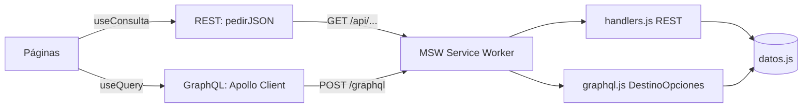

# Viajes Rumbo Sur · Destinos, vuelos y hoteles

| | |
|---|---|
| **Alumno** | Francisco Parra |
| **Asignatura** | Desarrollo Frontend II (PFY2202) |
| **Actividad** | Sumativa 2 – Semana 5: "Integrando nuestro frontend con backend" |
| **Sitio publicado** | https://fcoxavierparra.github.io/viajes-francisco-parra-pfy2202/ *(se activa al publicar)* |
| **Tecnologías** | React 18, React Router 7, Apollo Client 4 (GraphQL), MSW 2 (mock REST y GraphQL), Tailwind CSS 3, Vite 7, Vitest |

Aplicación de una agencia de viajes. El usuario explora destinos (**API REST mock**) y, al elegir uno, ve sus vuelos y hoteles con precios, fechas y disponibilidad (**API GraphQL mock**).

## Recorrido sugerido

1. En el **inicio** se listan los destinos con su país y actividades populares (`GET /api/destinos`). Se puede filtrar por país; el filtro queda en la URL (`?pais=Chile`).
2. Al elegir un destino se abre su **ficha** (`GET /api/destinos/:id`) y, en la misma página, sus **vuelos y hoteles** con una sola consulta GraphQL (`DestinoOpciones`).
3. En la página del destino: marcar **Solo opciones disponibles** (la consulta se repite con esa variable) y cambiar el **orden por precio**.
4. Abrir un destino inexistente, por ejemplo `/destinos/atlantida`, o una ruta que no existe.
5. En el **panel de pruebas** (al pie de la página) elegir un escenario (red lenta, servidor con error, sin conexión) y observar cómo responde la interfaz.

## Arquitectura



- **REST** (`src/api/rest/`, `src/api/cliente.js`): listado y detalle de destinos. Errores clasificados por tipo (`no-encontrado`, `servidor`, `red`, `tiempo`), tiempo máximo de 8 s y reintentos automáticos ante fallas temporales. Respuestas en caché por 5 minutos (`src/api/cache.js`).
- **GraphQL** (`src/api/graphql/`): Apollo Client con reintentos (`RetryLink`) solo ante fallas de red o 5xx, nunca ante errores GraphQL. Los errores se traducen al mismo tipo que REST (`errores.js`), así `MensajeError` muestra mensajes iguales en ambas APIs.
- **Mock**: MSW intercepta `/api/*` y `/graphql` en el navegador (Service Worker). En GitHub Pages no hay servidor propio, por eso el mock también se activa en producción. El contrato GraphQL está en [schema.graphql](schema.graphql).

### Estado con `useState` y `useEffect`

| Dónde | Qué |
|---|---|
| `pages/Inicio.jsx` | `useState` del filtro por país; `useEffect` lo sincroniza con la URL |
| `pages/Destino.jsx` | `useState` de *solo disponibles* y del orden; `useEffect` reinicia los filtros al cambiar de destino y cambia el título de la pestaña |
| `hooks/useConsulta.js` | `useState` + `useEffect` para cargar datos REST, mostrar datos guardados y descartar respuestas tardías |

## Rutas (React Router 7)

| Ruta | Página | Datos |
|---|---|---|
| `/` | Destinos, con filtro por país | REST `GET /api/destinos` |
| `/destinos/:id` | Ficha, vuelos y hoteles | REST `GET /api/destinos/:id` + GraphQL `DestinoOpciones` |
| `*` | Página no encontrada | — |

Rutas centralizadas en [src/routes/AppRoutes.jsx](src/routes/AppRoutes.jsx), con [Layout](src/layouts/Layout.jsx) común y carga diferida de páginas (`React.lazy`).

## Retroalimentación de S4 incorporada

El docente revisó la Formativa 3 (S4) y propuso dos mejoras. Ambas aplican a esta entrega y están resueltas:

| Observación del docente | Cambio en S5 | Dónde |
|---|---|---|
| Cancelar la petición al superar el tiempo máximo, para que no siga ejecutándose en segundo plano | Cada petición usa un `AbortController`: al vencer el tiempo máximo se cancela la petición real (REST) o la consulta (GraphQL). | [cliente.js](src/api/cliente.js), [apolloClient.js](src/api/graphql/apolloClient.js); prueba en [rest.test.js](src/test/rest.test.js) |
| Mensaje de recuperación si el mock no logra iniciarse | Si el Service Worker no se activa, se muestra una pantalla con la causa y un botón para reintentar, en vez de una página en blanco. | [main.jsx](src/main.jsx), [PantallaFalloMock.jsx](src/components/PantallaFalloMock.jsx); prueba en [arranque.test.jsx](src/test/arranque.test.jsx) |

## Estructura

```
├── index.html
├── schema.graphql                  Contrato GraphQL
├── public/mockServiceWorker.js     Service Worker de MSW
├── .github/workflows/deploy.yml    Pruebas, build y despliegue a GitHub Pages
└── src/
    ├── main.jsx                    Activa el mock, ApolloProvider y el router
    ├── routes/AppRoutes.jsx
    ├── layouts/Layout.jsx
    ├── api/
    │   ├── cliente.js              Cliente REST: errores, tiempo máximo, reintentos
    │   ├── cache.js                Caché REST y contadores del panel de pruebas
    │   ├── rest/destinos.js        Consultas REST
    │   └── graphql/
    │       ├── apolloClient.js     Cliente Apollo, tiempo máximo y reintentos
    │       ├── consultas.js        Consulta DestinoOpciones
    │       └── errores.js          Errores GraphQL → tipos comunes
    ├── hooks/useConsulta.js
    ├── mocks/
    │   ├── datos.js                Destinos, vuelos y hoteles
    │   ├── falla.js                Escenarios de error compartidos
    │   ├── handlers.js             Handlers REST
    │   ├── graphql.js              Handler GraphQL
    │   ├── browser.js              Service Worker
    │   └── simulacion.js           Escenarios elegidos en el panel de pruebas
    ├── pages/                      Inicio, Destino, NoEncontrado
    ├── components/                 Tarjetas, estados de carga y error, panel de pruebas, pantalla de fallo del mock
    ├── utils/formato.js            Precios en CLP y fechas en español
    └── test/                       Pruebas REST, GraphQL y de navegación
```

## Ejecución local

Requiere Node.js 24.

```bash
npm install
npm run dev      # http://localhost:5173 (el mock se activa solo)
npm test         # pruebas automatizadas
npm run build    # versión de producción en dist/
```

## Pruebas automatizadas

`npm test` ejecuta las pruebas con Vitest y Testing Library, usando los mismos handlers del sitio ejecutados en Node (`msw/node`).

| Archivo | Qué verifica |
|---|---|
| [rest.test.js](src/test/rest.test.js) | Listado con país y actividades; detalle; 404 sin reintentos; 500 con reintentos; falta de conexión; cancelación de la petición al superar el tiempo máximo |
| [arranque.test.jsx](src/test/arranque.test.jsx) | Pantalla de recuperación si el mock no inicia, con botón para reintentar |
| [graphql.test.js](src/test/graphql.test.js) | Vuelos y hoteles con precios, fechas y disponibilidad; filtro `soloDisponibles`; `NOT_FOUND`; 500 y red; caché de Apollo |
| [App.test.jsx](src/test/App.test.jsx) | Filtro por país; ficha con vuelos y hoteles; filtros y orden; destino inexistente; error de red; ruta 404; navegación de ida y vuelta |

El workflow de GitHub Actions ejecuta estas pruebas antes de publicar: si alguna falla, el sitio no se publica.

## Compatibilidad de navegadores

Matriz de pruebas manuales. Completar con la versión y el resultado real de cada prueba.

| Navegador | Versión | Escritorio | Móvil (DevTools) | Observaciones |
|---|---|---|---|---|
| Chrome | 157.0.8103.78 | ☑ (inicio, filtro por país, detalle, "Solo opciones disponibles" y panel de pruebas: error del servidor y sin conexión; orden por precio no probado) | ☑ (400 px, una columna) | Móvil probado a 400 px, no a 360 px |
| Edge | 157.0.4341.46 | ☑ (inicio, filtro por país, detalle, filtros, orden y panel de pruebas: error del servidor y sin conexión) | ☑ (402 px, una columna; panel y detalle) | Móvil probado a 402 px |
| Firefox | | ☐ | ☐ | |
| Safari (macOS o iOS) | | ☐ | ☐ | |

Lista de verificación por navegador: carga inicial; navegación entre inicio y un destino; filtro por país; filtros y orden de la página de destino; panel de pruebas con *Error del servidor* y *Sin conexión*; diseño a 360 px y 1280 px.

## Publicación

1. Crear el repositorio en GitHub y subir el contenido de esta carpeta.
2. En *Settings → Pages*, elegir **GitHub Actions** como origen.
3. Cada push a `main` ejecuta el workflow: pruebas, build con `BASE_PATH` igual al nombre del repositorio y publicación.

`404.html` se genera a partir de `index.html` para que las rutas de React Router funcionen al recargar en GitHub Pages.
