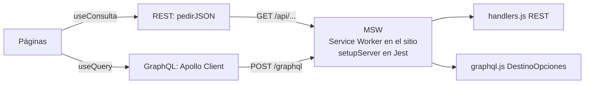

# Viajes Rumbo Sur · Pruebas unitarias con Jest y React Testing Library

| | |
|---|---|
| **Alumno** | Francisco Parra |
| **Asignatura** | Desarrollo Frontend II (PFY2202) |
| **Actividad** | Formativa 4 – Semana 6: "Desarrollando y ejecutando pruebas unitarias" |
| **Aplicación probada** | Agencia de viajes de la Sumativa 2 (S5): destinos por REST, vuelos y hoteles por GraphQL |
| **Sitio publicado** | https://fcoxavierparra.github.io/pruebas-unitarias-francisco-parra-pfy2202/ |
| **Informe de cobertura** | https://fcoxavierparra.github.io/pruebas-unitarias-francisco-parra-pfy2202/cobertura/ |
| **Tecnologías de prueba** | Jest 30, React Testing Library 16, user-event 14, MSW 2 (`msw/node`), Babel |

## Resultado

`npm test` ejecuta **98 pruebas en 15 archivos**, todas exitosas, y mide la cobertura de todo el código de la aplicación:

| Métrica | Exigido | Obtenido |
|---|---|---|
| Sentencias (Stmts) | ≥ 50 % | **98,13 %** (316 / 322) |
| Funciones (Funcs) | ≥ 50 % | **97,47 %** (116 / 119) |
| Líneas (Lines) | ≥ 50 % | **98,53 %** (269 / 273) |
| Ramas (Branch), no exigido | — | 90,32 % (168 / 186) |

El mínimo de 50 % está configurado como **umbral obligatorio** en Jest (`coverageThreshold` en [jest.config.cjs](jest.config.cjs)). Si alguna métrica bajara de ese valor, `npm test` fallaría y GitHub Actions no publicaría el sitio. El informe HTML, con el detalle archivo por archivo y las líneas cubiertas, se publica en cada despliegue en [/cobertura/](https://fcoxavierparra.github.io/pruebas-unitarias-francisco-parra-pfy2202/cobertura/).

### Cómo ejecutarlas

Requiere Node.js 24.

```bash
git clone https://github.com/FcoXavierParra/pruebas-unitarias-francisco-parra-pfy2202.git
cd pruebas-unitarias-francisco-parra-pfy2202
npm install
npm test                 # Jest con cobertura (tabla en consola + informe en coverage/index.html)
npx jest --verbose       # lista cada prueba por su nombre
npx jest src/test/hooks  # solo un grupo de pruebas
```

---

## Cumplimiento de la pauta

### 1. Implementación y utilización de Jest

**Configuración** ([jest.config.cjs](jest.config.cjs) y [babel.config.cjs](babel.config.cjs)):

| Opción | Para qué |
|---|---|
| `testEnvironment: "jest-fixed-jsdom"` | Simula el navegador (DOM) conservando `fetch`, `Request` y `Response` de Node, que MSW necesita para interceptar las peticiones |
| `transform` con `babel-jest` | Babel traduce JSX e `import/export` para Jest. El sitio se sigue compilando con Vite |
| `transformIgnorePatterns` | Transforma tres dependencias de MSW que solo se publican como módulos ES |
| `setupFilesAfterEnv` | [src/test/setup.js](src/test/setup.js) prepara cada prueba: servidor MSW, tiempos cortos, caché y almacenamiento limpios |
| `collectCoverageFrom` | Mide todo `src/`, salvo las pruebas, `main.jsx` y `mocks/browser.js`, que solo existen en el navegador real (Service Worker) |
| `coverageThreshold` | Exige ≥ 50 % de sentencias, funciones y líneas |

**Herramientas de Jest utilizadas en las pruebas:**

| Herramienta | Uso | Ejemplo |
|---|---|---|
| `describe`, `it`, `test` | Agrupar y nombrar cada caso | Todas las pruebas |
| `test.each` | Una prueba con una tabla de casos | [formato.test.js](src/test/utils/formato.test.js), [errores.test.js](src/test/api/errores.test.js), [MensajeError.test.jsx](src/test/componentes/MensajeError.test.jsx) |
| `jest.fn()` con `mockResolvedValue` y `mockRejectedValueOnce` | Simular funciones y contar sus llamadas | [cache.test.js](src/test/api/cache.test.js), [useConsulta.test.jsx](src/test/hooks/useConsulta.test.jsx) |
| `jest.spyOn(...).mockImplementation` | Simular un navegador que bloquea `localStorage` o `sessionStorage` | [cache.test.js](src/test/api/cache.test.js), [simulacion.test.js](src/test/mocks/simulacion.test.js) |
| `jest.useFakeTimers` y `jest.setSystemTime` | Adelantar el reloj 5 minutos para probar el vencimiento de la caché sin esperar | [cache.test.js](src/test/api/cache.test.js) |
| `jest.isolateModules` | Cargar un módulo desde cero, como si se recargara la página | [cache.test.js](src/test/api/cache.test.js), [simulacion.test.js](src/test/mocks/simulacion.test.js) |
| `toMatchSnapshot` | Detectar cambios inesperados en la estructura de un componente | [Tarjetas.test.jsx](src/test/componentes/Tarjetas.test.jsx) |
| Comparadores asíncronos (`resolves`, `rejects`) | Verificar promesas que se cumplen o fallan | [cache.test.js](src/test/api/cache.test.js), [rest.test.js](src/test/api/rest.test.js) |

### 2. Implementación y utilización de React Testing Library

Las pruebas buscan los elementos como lo haría el usuario, **por rol, nombre accesible, etiqueta o texto visible** (`getByRole`, `getByLabelText`, `findByRole`), nunca por clases internas. Las interacciones se simulan con **user-event**: clics, selección en listas y casillas de verificación.

| Nivel | Qué se prueba con RTL | Archivos |
|---|---|---|
| **Componentes simples** | Tarjetas con datos por props, botones y avisos, indicador de carga | [Tarjetas](src/test/componentes/Tarjetas.test.jsx), [ui](src/test/componentes/ui.test.jsx), [EstadoCarga](src/test/componentes/EstadoCarga.test.jsx) |
| **Componentes con interacción** | Mensajes de error con *Reintentar* (`jest.fn` recibe el clic); panel de pruebas que se abre, cambia el escenario del servidor y muestra contadores en vivo | [MensajeError](src/test/componentes/MensajeError.test.jsx), [PanelPruebas](src/test/componentes/PanelPruebas.test.jsx), [PantallaFalloMock](src/test/componentes/PantallaFalloMock.test.jsx) |
| **Hook de datos** | `renderHook`: estados cargando → datos → error, reintento, número de intento y descarte de respuestas que llegan tarde | [useConsulta](src/test/hooks/useConsulta.test.jsx) |
| **Flujos de datos en páginas completas** | Navegación con React Router y Apollo reales: listado de destinos por REST, filtro por país en la URL, ficha del destino con vuelos y hoteles por GraphQL, filtro "Solo opciones disponibles", orden por precio, errores con reintento, destino inexistente y ruta 404 | [navegacion](src/test/integracion/navegacion.test.jsx), [App](src/test/integracion/App.test.jsx) |

### 3. Pruebas unitarias para lograr cobertura del código

**MSW simula todas las integraciones con el backend.** Las pruebas usan los mismos handlers del sitio publicado ([handlers.js](src/mocks/handlers.js) para REST y [graphql.js](src/mocks/graphql.js) para GraphQL), ejecutados en Node con `setupServer` de `msw/node`. La configuración `onUnhandledRequest: "error"` hace fallar cualquier prueba que intente llamar a un endpoint sin mock. Los escenarios de falla (500, sin conexión, servidor inestable) se activan desde las mismas pruebas.

**Organización:** una carpeta por capa, que refleja la estructura de `src/`:

| Carpeta | Archivo | Pruebas | Qué verifica |
|---|---|---|---|
| `utils/` | [formato.test.js](src/test/utils/formato.test.js) | 9 | Precios en CLP, fechas sin desfase por zona horaria, cálculo de noches |
| `api/` | [rest.test.js](src/test/api/rest.test.js) | 7 | API REST mock: listado, detalle, 404 sin reintentos, 500 con reintentos, sin conexión, cancelación al superar el tiempo máximo |
| | [graphql.test.js](src/test/api/graphql.test.js) | 6 | API GraphQL mock con Apollo: vuelos y hoteles, `soloDisponibles`, `NOT_FOUND`, 500, red y caché de Apollo |
| | [errores.test.js](src/test/api/errores.test.js) | 8 | Traducción de cada tipo de error de Apollo al error común |
| | [cache.test.js](src/test/api/cache.test.js) | 11 | Reutilización, peticiones compartidas, vencimiento, fallas, suscripciones y almacenamiento bloqueado |
| `mocks/` | [simulacion.test.js](src/test/mocks/simulacion.test.js) | 8 | Escenarios del simulador y su recuperación al recargar |
| `hooks/` | [useConsulta.test.jsx](src/test/hooks/useConsulta.test.jsx) | 7 | Estados del hook y respuestas tardías |
| `componentes/` | 6 archivos | 31 | Mensajes de error, carga, tarjetas (con snapshot), botones, panel de pruebas, aviso de almacenamiento, pantalla de fallo del mock |
| `integracion/` | [navegacion.test.jsx](src/test/integracion/navegacion.test.jsx), [App.test.jsx](src/test/integracion/App.test.jsx) | 11 | Flujos completos de usuario |
| | **Total** | **98** | |

**Las pruebas detectan errores reales.** Se comprobó alterando el código a propósito. Si se quita la protección contra respuestas tardías del hook, o se cambia el código `NOT_FOUND` en la traducción de errores, la prueba correspondiente falla.

**Lo no cubierto y por qué:** quedan 4 líneas sin ejecutar, todas de casos defensivos:
- el navegador bloquea `localStorage` justo al abrir la página ([cache.js](src/api/cache.js));
- el servidor responde un código 4xx distinto de 404 ([cliente.js](src/api/cliente.js));
- falla la consulta GraphQL sin datos previos ([Destino.jsx](src/pages/Destino.jsx));
- un país sin destinos en el filtro ([Inicio.jsx](src/pages/Inicio.jsx)), que no ocurre con los datos actuales. Se excluyen de la medición `main.jsx` y `mocks/browser.js`, porque registran el Service Worker real del navegador, que no existe en Node; su comportamiento ante fallas se prueba con `PantallaFalloMock`.

---

## Continuidad con la Sumativa 2 (S5)

La aplicación es la misma agencia de viajes de S5, con su historial de commits. En S6 no cambió el funcionamiento del sitio, solo las pruebas:

| Cambio | Detalle |
|---|---|
| Vitest → **Jest** | Las 24 pruebas de S5 se migraron a Jest y se reorganizaron por carpetas |
| Pruebas nuevas | 74 pruebas unitarias nuevas de componentes, hook, caché, simulador, errores y formatos |
| Cobertura | Medida con Jest, con umbral obligatorio y publicada en GitHub Pages |
| Código de la aplicación | Solo se corrigió el comentario de ejemplo de las fechas en `formato.js` |

**Arquitectura de la aplicación probada:**



| Ruta | Página | Datos |
|---|---|---|
| `/` | Destinos, con filtro por país | REST `GET /api/destinos` |
| `/destinos/:id` | Ficha, vuelos y hoteles | REST `GET /api/destinos/:id` + GraphQL `DestinoOpciones` |
| `*` | Página no encontrada | — |

## Estructura de las pruebas

```
├── jest.config.cjs              Configuración de Jest y umbral de cobertura
├── babel.config.cjs             JSX e import/export para Jest
└── src/test/
    ├── setup.js                 Servidor MSW (REST + GraphQL), jest-dom, limpieza entre pruebas
    ├── utils/                   Funciones puras
    ├── api/                     Clientes REST y GraphQL, errores y caché
    ├── mocks/                   Simulador de escenarios del backend
    ├── hooks/                   useConsulta
    ├── componentes/             Componentes de interfaz (+ __snapshots__)
    └── integracion/             Flujos completos con React Router y Apollo
```

## Publicación

Cada push a `main` ejecuta GitHub Actions ([deploy.yml](.github/workflows/deploy.yml)) en este orden:
1. `npm test` (Jest con cobertura).
2. Build con Vite.
3. Publicación del sitio y del informe de cobertura en GitHub Pages.
